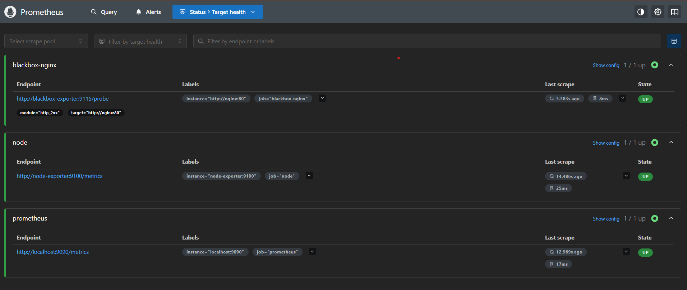
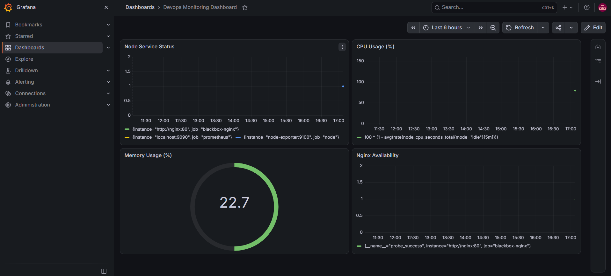

# Local DevOps Monitoring & Alerting Sandbox

A Docker Compose-based monitoring project using Prometheus, Grafana, Alertmanager, Node Exporter, Blackbox Exporter, and Nginx.

## Overview

This project demonstrates a local monitoring environment for collecting metrics, visualizing system health, checking endpoints, and configuring alerts.

## Technologies Used

- Docker Engine
- Docker Compose
- Prometheus
- Grafana
- Alertmanager
- Node Exporter
- Blackbox Exporter
- Nginx

## Project Structure

```text
devops-sandbox/
├── docker-compose.yml
├── README.md
├── .gitignore
├── prometheus/
│   ├── prometheus.yml
│   └── alert.rules.yml
├── alertmanager/
│   └── alertmanager.yml
├── grafana/
│   └── provisioning/
│       └── datasources/
│           └── datasource.yml
└── screenshots/
```

## Prerequisites

- Docker Engine
- Docker Compose plugin
- Git

## Setup and Installation

### 1. Clone the repository

```bash
git clone git@github.com:ruchikaborkar01-glitch/devops-sandbox.git
cd devops-sandbox
```

### 2. Start the services

```bash
docker compose up -d
```

### 3. Check service status

```bash
docker compose ps
```

## Service URLs

| Service | URL |
|---|---|
| Prometheus | http://localhost:9090 |
| Prometheus Targets | http://localhost:9090/targets |
| Grafana | http://localhost:3000 |
| Alertmanager | http://localhost:9093 |
| Node Exporter Metrics | http://localhost:9100/metrics |
| Blackbox Exporter | http://localhost:9115 |
| Nginx | http://localhost:8080 |

These URLs assume the services are running locally and the corresponding ports are published in `docker-compose.yml`.

## Monitoring and Alerting

- Prometheus collects metrics from configured targets.
- Alert rules are defined in `prometheus/alert.rules.yml`.
- Alertmanager handles alerts sent by Prometheus.
- Grafana provides dashboards for monitoring metrics.
- Node Exporter exposes system metrics.
- Blackbox Exporter supports endpoint probing.
- Nginx provides a sample web service.

## Screenshots

Add screenshots to the `screenshots/` directory and display them here when available.

Example:

```markdown


```

## Future Improvements

- Validate alert notifications end to end.
- Configure and test Blackbox probe targets.
- Improve Grafana dashboard coverage.
- Pin Docker image versions for reproducible deployments.
- Add troubleshooting documentation.

## Disclaimer

This project is intended for learning and demonstration. Review configuration, credentials, and network exposure before public or production deployment.
## Grafana Dashboard


